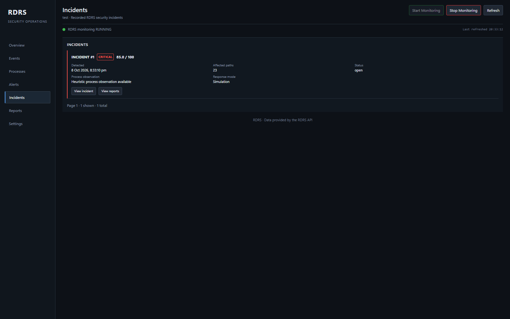
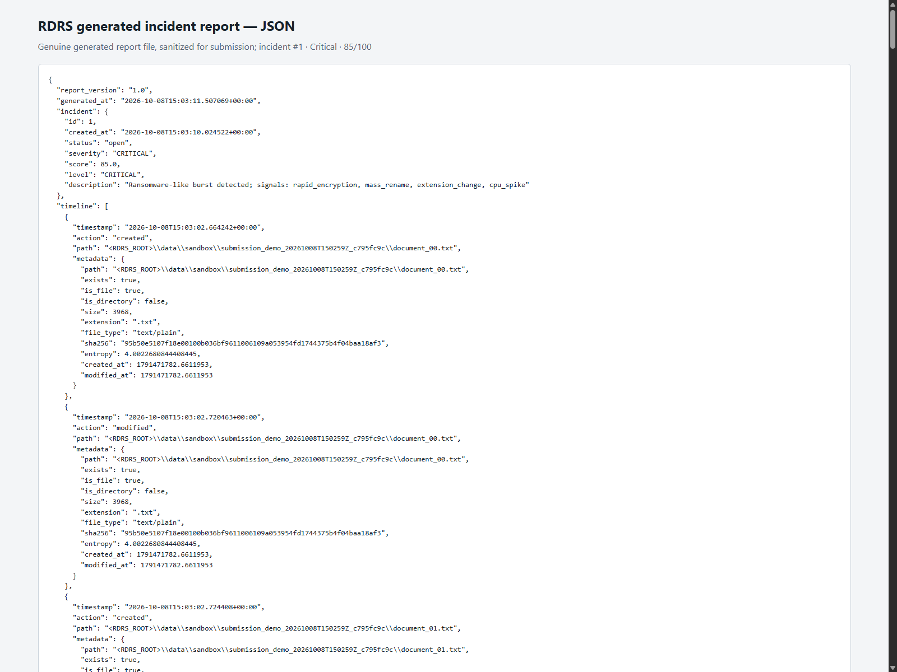
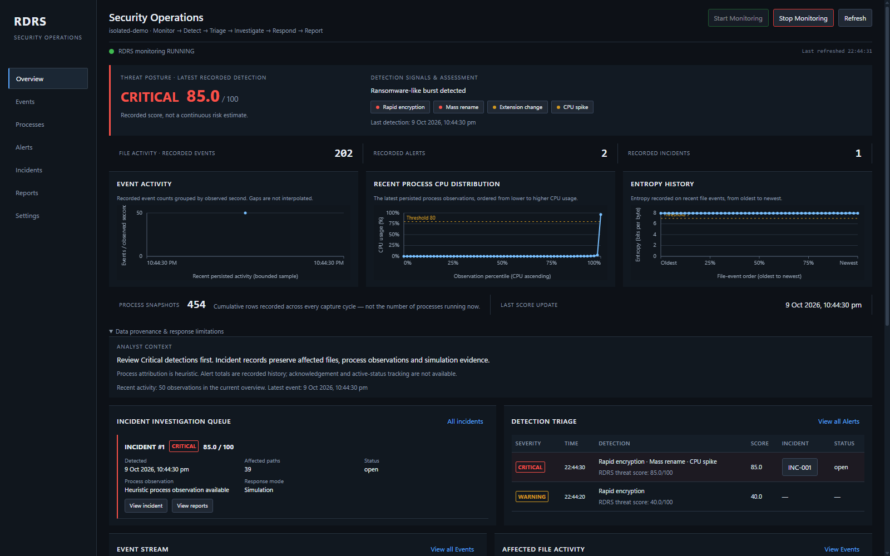

# RDRS — Ransomware Detection & Response System

A local-first defensive toolkit that watches configured paths for
ransomware-like file activity, records telemetry, scores bursts, and reports
incidents. It monitors only paths configured in `config.yaml`; it is not
host-wide protection by default.

> **Defensive tooling only.** RDRS detects ransomware-like behaviour and copies
> evidence for analysis. It never encrypts, never destroys data, and never
> kills real processes. Quarantine is copy-only and simulation mode is on by
> default.

## Implemented scope

| Area | Requirement | Status |
| --- | --- | --- |
| Config loading & validation | FR-01 | Implemented |
| Real-time file monitoring (create/modify/rename/delete) | FR-02 | Implemented |
| Shannon entropy analysis | FR-03 | Implemented |
| Process telemetry (`psutil`) | FR-04 | Implemented |
| SQLite persistence | FR-05 | Implemented |
| Sliding-window burst detection | FR-06 | Implemented |
| Weighted 0–100 threat scoring | FR-07 | Implemented |
| Alerts & incident records | FR-08 | Implemented |
| Evidence quarantine (copy-only) | FR-09 | Implemented |
| REST API | FR-10 | Implemented |
| Live dashboard | FR-11 | Implemented |
| JSON / CSV reports | FR-12 | Implemented |
| Automated tests + Docker | FR-13 | Implemented; dated release/deployment results below |

> Scope is FR-01–FR-13 and Build Guide Phases 1–10. See
> [authoritative scope](docs/AUTHORITATIVE_SCOPE.md) and
> [current release results](docs/RELEASE_VERIFICATION.md). Historical local
> Docker failures are separate from the healthy hosted service.
> Windows Docker bind-mount notification delivery remains unverified.

Threat bands: **Normal** `<40`, **Warning** `40–<70`, **Critical** `>=70` (capped at 100).

Scoring weights (Build Guide Phase 5): rapid encryption 40, mass rename 30,
high entropy 25, CPU spike 15, unknown program 10.

## Requirements

- Python `>=3.11` per `pyproject.toml`; the container uses Python 3.13.
- Dependencies: `python -m pip install -e . -r requirements.txt`

## Technology stack

- Python, FastAPI, and Uvicorn for the runtime API and dashboard server.
- watchdog for filesystem notifications and psutil for process snapshots.
- SQLAlchemy with SQLite for persisted events, alerts, incidents, and history.
- YAML configuration and a single-page HTML/CSS/JavaScript dashboard.
- Node.js dashboard harness and pytest backend/integration tests.
- Docker Compose for containerized local runs.

## Quick start

```bash
pip install -e . -r requirements.txt

# Start the API + dashboard on http://127.0.0.1:8000
uvicorn rdrs.api:app --host 127.0.0.1 --port 8000
```

Open `http://127.0.0.1:8000/` for the dashboard.

The server loads the repository's `config.yaml`. Set `runtime.watch_paths` only
to directories intended for monitoring. The sample configuration watches
`data/`; persistence is enabled by default, and simulation mode is on by
default. Never point a demonstration at personal or production data.

## CLI

```bash
rdrs status
rdrs start
rdrs stop
```

## REST API

| Method | Path | Purpose |
| --- | --- | --- |
| GET | `/` | Live dashboard (HTML) |
| GET | `/health` | Liveness + subsystem health |
| GET | `/status` | Runtime status snapshot |
| POST | `/monitor/start` | Start filesystem monitoring |
| POST | `/monitor/stop` | Stop filesystem monitoring |
| GET | `/events` | Persisted file events |
| GET | `/processes` | Process telemetry snapshots |
| GET | `/alerts` | Alerts raised |
| GET | `/incidents` | Incidents raised |
| GET | `/dashboard-data` | Aggregated dashboard payload |
| GET | `/scan` | Return scan usage information |
| POST | `/scan` | Trigger a scan (with parameters) |
| GET | `/reports` | List incidents eligible for reports; downloads return 404 if no report exists |
| POST | `/reports/generate` | Generate a JSON/CSV incident report |
| GET | `/reports/{incident_id}/{format}` | Download a report (`json` or `csv`) |
| POST | `/settings` | Update runtime settings (persisted to the config file) |

## Operational logs

Five size-rotated logs are written under the configured `logs_dir`
(Build Guide Phase 1):

| Log | Contents |
| --- | --- |
| `system.log` | Runtime lifecycle transitions |
| `events.log` | Every observed file event |
| `alerts.log` | Threat detections and alerts |
| `errors.log` | Pipeline and runtime failures |
| `audit.log` | Critical-incident audit trail |

## Docker

One-command startup:

```bash
docker compose up --build
```

Then open <http://127.0.0.1:8000>.

Useful commands:

```bash
docker compose up --build -d          # start detached
docker compose ps                     # container + health status
docker compose logs -f rdrs           # follow the application log
docker compose down                   # stop and remove the container
docker compose up --build --force-recreate   # rebuild from scratch
```

### Image

| Property | Value |
| --- | --- |
| Base | `python:3.13-slim` — satisfies `requires-python >= 3.11` and the Guide's 3.12+ |
| Working directory | `/app` |
| User | `rdrs` (uid 1001, system account) — **not root** |
| Container port | `8000` |
| Published host port | `127.0.0.1:8000` (loopback only) |
| Entrypoint | `uvicorn rdrs.api:app --host 0.0.0.0 --port 8000` |
| Healthcheck | calls `/health` and requires HTTP 200 plus JSON `healthy: true` |
| Build context | filtered by `.dockerignore` — no `.venv`, `.git`, databases, logs, caches, secrets or reports |

Writable paths inside the image are `/app/data` and `/app/logs`, both owned by
`rdrs` and both backed by host bind mounts. Nothing else in the container
filesystem changes at runtime.

### Volumes

| Host | Container | Holds |
| --- | --- | --- |
| `./data` | `/app/data` | SQLite database, `sandbox/`, `reports/`, `quarantine/` |
| `./logs` | `/app/logs` | rotating `system` / `events` / `alerts` / `errors` / `audit` logs |
| `./config.yaml` | `/app/config.yaml` | the canonical configuration (FSD FR-1) |

`config.yaml` is mounted **read-write on purpose**: `POST /settings` persists
changes back to that file so they survive a restart, and a read-only mount would
make every settings save fail.

Because `runtime.watch_paths` is `['data']`, the container monitors `/app/data`,
which is the project's own sandbox area — not a sensitive host directory.

### Persistence

Behaviour is identical to a local run:

* **Enabled** — the SQLite database at `data/rdrs.db` lives on the host through
  the `./data` mount, so history survives `docker compose down` and a rebuild.
* **Disabled** — the runtime uses an in-memory database; the mounted
  `data/rdrs.db` is left untouched and becomes visible again when persistence is
  re-enabled.

### Docker verification status

**Historical runtime verification (2026-10-08).**

Docker Engine 29.8.0 and Compose 5.5.1 built the current image with
`docker compose build --no-cache`. The container reached `healthy`, `/health`
and `/status` returned a healthy `RUNNING` runtime, and the published port was
`127.0.0.1:8000`. Bind-mounted SQLite history survived restart; clean shutdown
and fresh startup succeeded. Static Docker tests passed (49 checks).

**Historical local release-check status (2026-10-09):** the `rdrs` container was
`running` but `unhealthy`. `/health` reports `healthy: false` with the
process-monitor subsystem unhealthy, and `/dashboard-data` returns HTTP 500.
The most recent process-monitor error reports SQLite `database disk image is
malformed`. No database repair or Docker restart was performed. Historical
results below are not a claim that the current runtime is healthy.

The latest storage change maintains an exact process-history count using a
persistent SQLite aggregate and transactional triggers. It preserves existing
history and the dashboard response schema. At one post-restart snapshot, a direct
SQLite count and the persistent aggregate both read 2,426,282 process rows; the
count continues increasing during monitoring. The latest five Docker
`/dashboard-data` requests measured 61.30, 114.60, 21.60, 17.90 and 31.41 ms
(median 31.41 ms; all samples shown). Browser first-data measurements were
175.1, 64.2 and 59.0 ms (median 64.2 ms), compared with prior Docker medians of
4,768 ms and 5,293 ms. The read-only exact full-table verification scan itself
took 8.101 seconds; dashboard refresh uses the indexed aggregate lookup instead.

To repeat the runtime verification:

```bash
docker compose up --build -d
docker compose ps                       # expect "healthy"
curl -s http://127.0.0.1:8000/health
curl -s http://127.0.0.1:8000/status
# run the section-15 sandbox script against data/sandbox, then:
curl -s -X POST "http://127.0.0.1:8000/reports/generate?incident_id=1&format=json"
docker compose down && docker compose up -d
# confirm the incident and event counts are still present after the restart
```

## Testing

```bash
python -m pytest tests/ -q
```

The suite covers unit tests and integration tests (config, entropy, detection,
scoring, persistence, response, API, dashboard data, reporting, logging and
runtime lifecycle).

The last full-suite result recorded above is from 2026-10-08. The final
submission check did not rerun database-backed tests because the current
environment has an unresolved persistent-database health error. Before running
runtime tests against an active instance, use an isolated temporary
configuration and database; do not target the live `data/rdrs.db`.

### Front-end verification

The dashboard's own JavaScript is executed, not just inspected. `pytest`
invokes a Node harness that loads the real `<script>` block out of
`src/rdrs/dashboard/index.html` into a `vm` context with a DOM stub and drives
the real functions (refresh, control buttons, settings rendering):

```bash
node tests/dashboard_frontend_harness.mjs
```

**Prerequisite:** Node.js (the harness is run from `pytest`, so a missing
Node fails the suite rather than silently skipping front-end verification).

### Environment note — editable install path

`import rdrs` resolves through
`.venv/Lib/site-packages/__editable__.rdrs-0.1.0.pth`. That file must point at
**this** checkout's `src` directory. If it points at another copy of the
project, `pytest` still tests this tree (via `pythonpath = ["src"]`) while
`uvicorn rdrs.api:app` and ad-hoc scripts silently run the other copy — so a
fix can appear to have no effect. Verify with:

```bash
python -c "import rdrs; print(rdrs.__file__)"
```

> **Windows note:** the WorkBuddy sandbox ships a `safe-delete` shim that
> intercepts file deletion. It can cause spurious errors when tests clean up
> `data/rdrs.db`. Running the suite with a clean interpreter avoids this; the
> same tests pass without the shim.

## Safety

- Detection and response only — no offensive capability.
- Quarantine copies evidence; originals are never modified or removed.
- Simulation mode is enabled by default and must be explicitly disabled.
- Never point RDRS at personal or production data during testing; use the
  dedicated sandbox directory from the Build Guide (section 15).


## Architecture

RDRS is a single Python package with one responsibility per module. The runtime
owns the lifecycle; the API and dashboard are thin layers over it.

```
                    ┌──────────────────────────────┐
                    │   cli.py / api.py (FastAPI)  │   entry points
                    └───────────────┬──────────────┘
                                    │
                    ┌───────────────▼──────────────┐
                    │        runtime.py            │   lifecycle, wiring,
                    │  RuntimeManager / Status     │   persistence mode
                    └──┬────────┬────────┬─────────┘
                       │        │        │
        ┌──────────────▼─┐ ┌────▼─────┐ ┌▼──────────────┐
        │ monitoring.py  │ │telemetry │ │  storage.py   │
        │ watchdog file  │ │  .py     │ │ SQLAlchemy +  │
        │ events (FR-2)  │ │ psutil   │ │ SQLite (FR-5) │
        └───────┬────────┘ │ (FR-4)   │ └───────┬───────┘
                │          └────┬─────┘         │
                │               │               │
        ┌───────▼───────────────▼───────────────▼───────┐
        │            burst_detection.py (FR-6)          │
        │   sliding time window -> active signals       │
        └───────────────────┬───────────────────────────┘
                            │
                 ┌──────────▼──────────┐
                 │    scoring.py       │   weighted 0-100 (FR-7)
                 └──────────┬──────────┘
                            │
                 ┌──────────▼──────────┐
                 │    response.py      │   alerts + incidents (FR-8)
                 │    quarantine.py    │   copy-only evidence (FR-9)
                 └──────────┬──────────┘
                            │
                 ┌──────────▼──────────┐
                 │ dashboard_data.py   │   aggregates one payload
                 │ dashboard/index.html│   live UI (FR-11)
                 └─────────────────────┘
```

Supporting modules: `config.py` / `config_engine.py` (FR-1 loading, validation
and comment-preserving save), `entropy.py` (FR-3 Shannon entropy over a 64 KB
sample), `logging.py` / `audit.py` (rotating logs), `events.py` (in-process
event bus), `health.py` (subsystem health), `policy.py` and `workers.py`
(thread-pool helpers), `fileaccess.py` (shared-mode reads so a read never blocks
a rename or delete).

**Data flow:** file events and process snapshots are persisted, then evaluated in
a sliding window. When enough signals fire, a weighted score is computed; a
CRITICAL score creates an alert and an incident, and evidence is **copied** to
quarantine. The incident's process field is a highest-CPU process snapshot
heuristic; it does **not** establish which process performed the file changes.
The dashboard reads one aggregated payload rather than querying the database
itself.

## Detection signals and false positives

The detector fires on five signals, each weighted (see `config.yaml`):

| Signal | Fires when | Weight |
| --- | --- | --- |
| `rapid_encryption` | many distinct files modified inside the window | 40 |
| `mass_rename` | many renames inside the window | 30 |
| `high_entropy` | average entropy of modified files is high | 25 |
| `cpu_spike` | the suspect process is CPU-busy | 15 |
| `unknown_program` | the process snapshot has neither a readable name nor executable path | 10 |

Bands: **NORMAL** `< 40`, **WARNING** `40–<70`, **CRITICAL** `>= 70`. Only
CRITICAL creates an incident.

**False positives are the main practical risk for a detector like this**, and the
design accepts that trade-off deliberately. The signals that most often produce
them:

* **`high_entropy`** — compressed archives, encrypted backups, disk images, and
  large media files are *legitimately* high-entropy. A single `.zip` or `.mp4`
  being written can look like encryption. This is mitigated by requiring a
  *burst* (many files in the window) rather than one file, and by the
  `average_entropy` threshold acting alongside the file-count signals rather
  than alone.
* **`mass_rename`** — bulk organisation scripts, archive extraction, and build
  tools (which create and rename hundreds of files quickly) all rename en masse.
  A `git checkout`, `npm install`, or unzip of a large archive can resemble this.
* **`rapid_encryption`** — any tool that rewrites many files in place, such as a
  backup restore, a bulk metadata edit, or a formatter run across a repository.
* **`cpu_spike` / `unknown_program`** — a legitimate compile or video encode
  raises CPU, and any non-system executable (including a user's own script)
  counts as unknown. These carry the lowest weights for that reason.

**Mitigations in the current implementation:** thresholds are tuned so that
normal activity stays below the WARNING band while a genuine burst reaches
CRITICAL; scoring is weighted rather than binary; and `unknown_program` /
`cpu_spike` alone can never reach CRITICAL. **Not yet implemented:** an
allow-list of known-good directories, processes or extensions, and a per-path
exclusion for backup/archive locations. These are the first things to add in a
real deployment — see *Future improvements*.

## Persistence modes

`persistence.enabled` in `config.yaml`, also editable on the Settings page:

| Mode | Behaviour |
| --- | --- |
| **Enabled** | A file-backed SQLite database at `persistence.db_path`. Events, processes, alerts, incidents and scores survive a **process restart**. |
| **Disabled** | An **in-memory** database (`db_path` is `None`, no file is created). Everything works while the process lives, including stop/start of monitoring, but history is **lost when the process exits**. |

Switching the setting replaces the database manager for the running process. It
**does not delete anything**: the file-backed database and every row in it are
left untouched, so re-enabling persistence brings the previous history back.
Turning persistence *off* makes that history **invisible, not deleted** — which
is the intended behaviour, but is worth knowing before it looks like data loss.

> Both modes keep data across a **stop/start of monitoring** within the same
> process. The difference only appears when the process itself restarts.

## Known limitations

* **Filesystem notifications on a Windows Docker bind mount are untested.** watchdog relies on
  native filesystem notifications; behaviour on a bind-mounted volume (Docker
  Desktop on Windows in particular) may differ from the host. Docker process
  telemetry covers the container namespace, not all host processes.
* **No login/account system.** Local administrative access is trusted and
  origin-checked. Hosted Nginx exposes explicitly allowed GET reads with backend
  redaction; mutations/admin routes are blocked. Port 8000 is loopback-only.
  Private original details require an authenticated SSH tunnel.
* **Process attribution is heuristic.** The runtime associates the current
  highest-CPU process snapshot with a file burst; watchdog events do not carry
  a process ID, so the snapshot is not proof that this process changed the files.
* **Single-process only.** SQLite plus in-process runtime state means the app is
  not safe to run as multiple replicas.
* **No allow-list / exclusion tuning** for false positives (see above).
* **Hosted monitoring is scoped** to configured container volumes and its
  process namespace; it does not protect visitors' computers or the whole VPS.
* A long-running instance accumulates process snapshots quickly; the bundled
  database can grow large during extended testing.

## Verification status

Verification results are dated historical records, not a fresh full-suite run.
The final scoped release run passed 246 backend tests and 124 frontend checks;
see [release verification](docs/RELEASE_VERIFICATION.md).
Historical runtime checks must not be confused
with the current Docker availability noted above:

| Area | Status |
| --- | --- |
| Full backend suite (last full run, 2026-10-08) | **835 passed, 0 failed, 0 skipped** |
| Line coverage (last full run, 2026-10-08) | **94%** (3,557 statements) |
| Dashboard JavaScript harness (`node tests/dashboard_frontend_harness.mjs`) | **124 passed, 0 failed** (2026-10-09 final evidence check) |
| Encoding and safety scan (`python tests/encoding_safety_scan.py`) | **22/22 passed** (2026-10-09 final evidence check) |
| Safe sandbox live E2E | Previously produced Critical 85/100, incident #1, 10 hash-verified quarantine copies, and sanitized reports/logs in an isolated local runtime. |
| Isolated dashboard demo (2026-10-09) | `/health`, `/dashboard-data`, `/events`, `/processes`, `/alerts`, `/incidents`: **HTTP 200** against a new temporary config/database; displayed summary: 202 events, 454 process snapshots, 2 alerts, 1 incident. |
| Docker static configuration (`tests/unit/test_docker_configuration.py`) | **49 passed** (2026-10-09 final evidence check) |
| Docker build/runtime/persistence/restart | **Passed historically** after the exact-count performance fix; current container is running but unhealthy. |
| Docker `/dashboard-data` | **31.41 ms median historically** (five-request sample; 114.60 ms maximum); current endpoint returns HTTP 500. |
| Docker browser first data | **64.20 ms median historically** for three navigations; zero browser errors in that run. |

## Design, testing and future improvements

**Design choices.** The system is deliberately modular with one responsibility
per file, so each stage (monitor → detect → score → respond → report) can be
tested in isolation. Persistence is SQLite via SQLAlchemy because it needs no
server and the dataset is single-machine. The runtime owns the database
lifecycle: read endpoints never close it, because doing so raced concurrent
reads and produced 500s while monitoring was stopped. The dashboard renders one
aggregated payload per poll instead of issuing many small requests. A prior
local benchmark recorded ~0.08 s dashboard reads on a database with ~980k process
rows (down from ~8.5 s); that benchmark was not repeated in this verification
cycle.

**How it was tested.** The backend suite covers config, storage, detection,
scoring, API routes and runtime lifecycle. The front-end harness executes the
dashboard's actual JavaScript in a Node VM with a DOM stub, including paging
through server-provided cursors. The encoding/safety scan checks source and
served response bytes, simulation defaults, copy-only quarantine, and unchanged
detection thresholds. The live safe-sandbox E2E verified the real event-to-report
chain. Docker was rebuilt without cache, its health-checked API was exercised,
and database history was checked across restart.

**One false positive considered.** A user archiving a project directory would
create many new files and rename many others in a short window, and a `.zip` or
`.7z` output is high-entropy — three signals at once. The current thresholds
would likely raise a WARNING and could reach CRITICAL for a large archive. The
burst requirement (many *distinct* files) is what keeps a single large file from
triggering, but a bulk archive job is a genuine false-positive scenario, and the
right fix is a path exclusion for backup/archive locations.

**What I would improve next, in order:**
1. A **path and process allow-list** so backups, archives, build directories and
   known tools can be excluded — the single highest-value change.
2. **Make watchdog notifications on Windows Docker bind mounts reliable.** During the 2026-10-08 safe demo, Docker was healthy but did not receive the host file events; the detection evidence was captured with an isolated local runtime. The current container is running but unhealthy, as noted above.
3. **Authenticate the API** and make the local-origin check configurable, so it
   could run on a host rather than only on a workstation.
4. **Retention for process snapshots** — the table grows without bound; a
   time-based prune would keep the database small.
5. **Retain sanitized submission evidence** in `submission/`: a genuine incident
   dashboard capture, incident-scoped JSON/CSV reports, and event/alert/audit
   log excerpts. Raw runtime outputs remain under ignored `data/` and `logs/`.

## Submission evidence

The retained `submission/screenshots/01-dashboard.png` was captured on
2026-10-09 from a separate temporary
configuration, database, and sandbox under ignored `ptmp/`. Its real summary
was 202 events, 454 cumulative process snapshots, 2 alerts, and 1 incident.
It does **not** show the unhealthy Docker instance or its database.



This genuine dashboard incident card is from the earlier 2026-10-08 safe
sandbox run and is separate from the isolated 2026-10-09 Overview capture. It
does not represent the current Docker health state. See the [demonstration write-up](submission/WRITEUP.md),
[sanitized JSON report](submission/evidence/reports/incident_report.json),
[sanitized CSV report](submission/evidence/reports/incident_report.csv), and
[sanitized event/alert/audit excerpts](submission/evidence/logs/incident_log_excerpts.jsonl).





The current Docker API still returns HTTP 500 for `/dashboard-data`; no screenshot
of that unhealthy runtime was used. The Overview image above comes only from the
separately configured disposable runtime and real data it generated.

## Deployment status

**Public read-only dashboard:** https://192.46.208.222/

The Akamai VPS deployment was initially verified on 2026-10-10 with fresh
persistent storage. Original historical records were subsequently imported and
preserved. On 2026-10-12, actual Chrome local/hosted checks passed all seven pages,
event/process pagination, four incident timelines and existing redacted JSON/CSV
downloads. All 1,577 events, sampled process pages and eight report responses
passed redaction checks. Public administrative operations and scan/settings/docs
routes returned HTTP 403. Port 8000 is VPS-loopback only.
See [deployment commands and actual verification results](deploy/README.md).

The public service is an HTTPS read-only reviewer interface, not an authenticated
production security console. Administrative buttons are retained but blocked.
IDs, scores, timestamps, signals and numeric telemetry remain; paths/process
names are pseudonymized, commands and unapproved evidence fields removed.
Pseudonyms are consistent within a server process and can change after restart.
Free-text descriptions/recommendations and some metadata/file types are redacted.
Public report buttons download existing redacted files without generating evidence.
Original reports/private details remain accessible through an authorized SSH tunnel.
The local malformed database remains untouched and separate from the healthy
VPS database. RDRS monitors configured mounted paths and the container process
namespace; it is not comprehensive host-level ransomware protection.

Copy buttons use the browser Clipboard API over HTTPS. The public IP has a
trusted short-lived certificate with automatic renewal checks. If clipboard
permission is denied, the UI reports failure explicitly and leaves the full
path available on hover. See the deployment notes for exact browser paste tests.

## Internmo source and submission

Private repository: <https://github.com/samyakbhaisare/Ransomware-Detection-and-Response-System>.
The controlled-manifest `RDRS-CLI-SUBMISSION.zip` is distributed separately from
Git source and excludes databases, caches, credentials and raw evidence stores.
See [submission evidence](submission/evidence/README.md),
[design write-up](submission/WRITEUP.md) and [release results](docs/RELEASE_VERIFICATION.md).



All five original screenshots are preserved. They depict dated safe runs,
not today's changing live counters. Older Docker failures are historical local
checks, not claims that the currently verified VPS is unhealthy.
