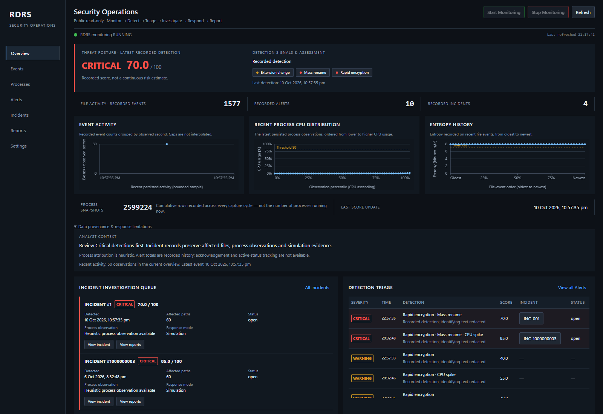
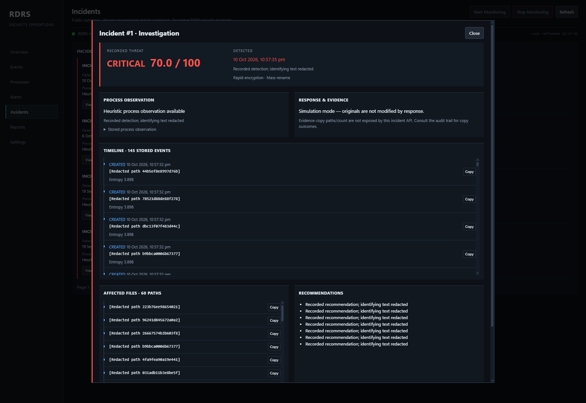
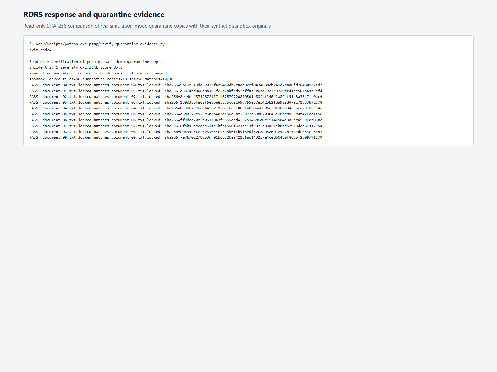
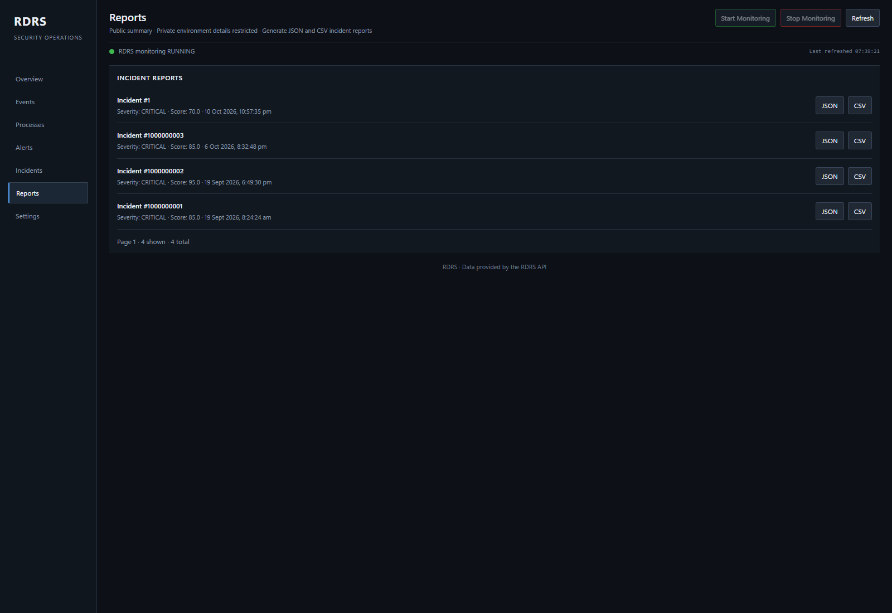
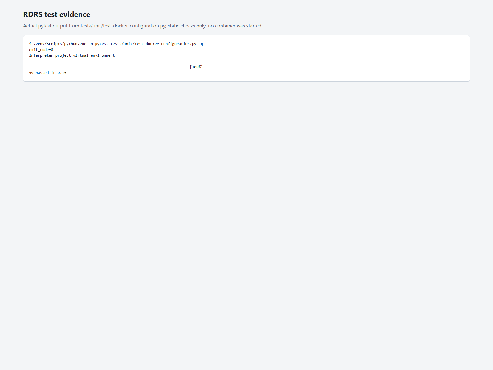

# RDRS — Ransomware Detection & Response System

## [Live SOC Dashboard → rdrs.samyaktech.in](https://rdrs.samyaktech.in/)

RDRS is a defensive, rules-based cybersecurity application that monitors
configured file-system activity and process telemetry, detects ransomware-like
bursts, records alerts and incidents, and preserves evidence for investigation.
Its SOC interface connects detection, triage, incident timelines and reporting
to the same persisted data.

The hosted dashboard provides **redacted, read-only reviewer access**. Monitoring
controls and administrative changes remain private. RDRS is an educational
detection/response project, not comprehensive endpoint protection or a guarantee
of ransomware prevention.

## Key capabilities

- **Configuration and sensors — FR-01–FR-04:** validated YAML settings,
  real-time create/modify/delete/rename events, Shannon entropy analysis using
  64 KB samples, and psutil process metadata/resource observations.
- **Persistence and detection — FR-05–FR-07:** SQLite history, configurable
  sliding-window analysis and transparent weighted threat scoring from 0 to 100.
- **Response and evidence — FR-08–FR-09:** alerts, incident records and copy-only
  quarantine in simulation mode. Originals are not deleted or encrypted.
- **Investigation and reporting — FR-10–FR-12:** FastAPI reads, seven SOC pages,
  incident-scoped timelines, cursor pagination and JSON/CSV incident reports.
- **Verification and packaging — FR-13:** backend/integration tests, frontend
  regression checks and Docker Compose deployment.

Threat bands are **Normal `<40`**, **Warning `40–<70`**, and **Critical `>=70`**.
The default weights are rapid encryption 40, mass rename 30, high entropy 25,
CPU spike 15 and unknown program 10; the total is capped at 100. A Critical
detection creates an incident. Thresholds and weights are configurable.

The implementation follows the [FSD-aligned scope](docs/AUTHORITATIVE_SCOPE.md)
and Hands-On Build Guide Phases 1–10.

## Project evidence

### 01 — SOC Dashboard



**Production capture, 2026-10-15 UTC.** Monitoring status and counters reflect
capture time; the displayed Critical 70/100 detection is a stored October 10
event, not a newly triggered attack.

### 02 — Incident Investigation



**Production capture, 2026-10-15 UTC.** Genuine incident #1 shows its recorded
severity/signals, simulation response, 60 affected paths and 145-event report
timeline. Identifying details are redacted in the public view.

### 03 — Response / Quarantine



**Historical safe-sandbox evidence, October 2026.** Ten quarantine copies matched
their original sandbox files by SHA-256. Public incident reads do not expose copy
outcomes, so this authentic verification is retained instead of implying a fresh
production quarantine operation.

### 04 — Reports



**Production capture, 2026-10-16 UTC.** The Reports interface lists four genuine
stored incidents. Public JSON/CSV buttons download existing redacted reports;
they do not generate new reports or modify evidence. Sample
[JSON](submission/evidence/reports/incident_report.json) and
[CSV](submission/evidence/reports/incident_report.csv) outputs document the
separate historical safe-sandbox run.

### 05 — Testing / Verification



**Historical static verification, 2026-10-09.** Actual pytest output records
49 passing Docker configuration checks. This is static test evidence, not a
new container deployment or a claim that a full suite was rerun today.

## Technology stack

- **Python, FastAPI and Uvicorn** — runtime, REST API and application server.
- **watchdog and psutil** — file notifications and process telemetry.
- **SQLAlchemy and SQLite** — durable records and incident history.
- **YAML and HTML/CSS/JavaScript** — configuration and the dark SOC dashboard.
- **pytest, pytest-cov and Node.js** — backend tests and frontend harness.
- **Docker Compose and Nginx** — deployment and restricted HTTPS reviewer access.

## Architecture and detection workflow

```text
Configured paths + process snapshots
                 │
        monitoring / telemetry
                 │
        SQLite event history
                 │
      sliding-window burst analysis
                 │
      weighted threat score (0–100)
                 │
      alerts → incidents → evidence copies
                 │
      API → SOC dashboard / JSON–CSV reports
```

`runtime.py` owns lifecycle, monitoring and health state. `config.py`,
`monitoring.py`, `telemetry.py`, `burst_detection.py`, `scoring.py`,
`response.py` and `storage.py` separate the main responsibilities.
`dashboard_data.py` supplies the UI data; `public_redaction.py` applies the
server-side public projection. Five rotating logs record system, event, alert,
error and audit activity.

Detection correlates rapid modification, rename/extension activity, entropy
and process resource signals within a configurable time window. Process
association is a highest-CPU snapshot heuristic, **not proven attribution** of
which process changed a file.

## Installation and local execution

Use Python **3.12 or newer** as recommended by the Build Guide. The package
declares Python `>=3.11`; the Docker image uses Python 3.13. Node.js is required
for the frontend test harness.

```bash
python -m venv .venv
# Windows: .venv\Scripts\activate
# Linux/macOS: source .venv/bin/activate
python -m pip install -e . -r requirements.txt
python -m uvicorn rdrs.api:app --host 127.0.0.1 --port 8000
```

Open <http://127.0.0.1:8000/>. The canonical `config.yaml` controls watch paths,
thresholds and persistence. Use only an explicitly selected sandbox for testing;
never run simulations against personal files or the live deployment.

## Docker execution

```bash
docker compose up --build -d
docker compose ps
docker compose logs -f rdrs
```

Open <http://127.0.0.1:8000/>. The container runs as an unprivileged user and
publishes the backend on loopback. Host bind mounts preserve `data/`, `logs/`
and `config.yaml`; the health check requires the application's actual
`healthy: true` response. See [deployment documentation](deploy/README.md)
for the separate VPS gateway configuration.

## CLI and REST API

```bash
rdrs status
rdrs start
rdrs stop
```

**Read endpoints:** `/health`, `/status`, `/dashboard-data`, `/events`,
`/processes`, `/alerts`, `/incidents`, `/reports` and
`/reports/{incident_id}/{json|csv}`. Collection reads support bounded limits
and cursor pagination. `/reports` lists incidents eligible for reports; a
download returns 404 if no generated file exists.

**Local administrative endpoints:** `POST /monitor/start`, `/monitor/stop`,
`/scan`, `/settings` and `/reports/generate`. These are blocked on the public
gateway. Local API documentation is available at `/docs`.

## Testing and verification

Run tests only with isolated temporary configuration/data:

```bash
python -m pytest tests/ -q
node tests/dashboard_frontend_harness.mjs
```

Recorded checks include **246 scoped backend tests and 124 frontend checks**
on October 12, followed by **34 API/redaction tests and 124 frontend checks**
on October 15. The October 8 full-suite result was **835 passed**, with recorded
94% line coverage; it is historical, not a new measurement.

Actual Chrome local/hosted comparisons verified all seven pages, event/process
pagination, four incident timelines and existing report downloads. Domain HTTPS,
public reads and restricted routes were checked separately. See
[dated release verification](docs/RELEASE_VERIFICATION.md) and the
[safe demonstration write-up](submission/WRITEUP.md) for provenance and limits.

## Security boundaries and known limitations

- The public gateway allows explicit read routes only, forces backend redaction,
  and rejects administrative/mutating requests. There is no public login page.
- IDs, timestamps, scores, signals and numeric telemetry remain visible. Paths
  and names are pseudonymized; commands, private evidence and unapproved fields
  are removed. Pseudonyms may change after a server restart.
- Private original data requires authorized loopback/SSH access. Never publish
  raw databases, quarantine stores, credentials or private recovery archives.
- Simulation mode is on by default and quarantine is copy-only. RDRS does not
  execute malware or kill real processes.
- Hosted monitoring covers configured container volumes/processes, not visitors'
  machines or the whole VPS. Windows Docker bind-mount notifications remain
  unverified for the target host.
- Backup/archive workloads can cause false positives. Process attribution is
  heuristic, process history needs retention planning, and the architecture is
  single-runtime rather than a multi-replica platform.
- Dependency versions are not fully pinned. Historical operational failures and
  untested recovery scenarios remain documented in the verification records;
  screenshots are not proof of continuous uptime or current attack activity.
