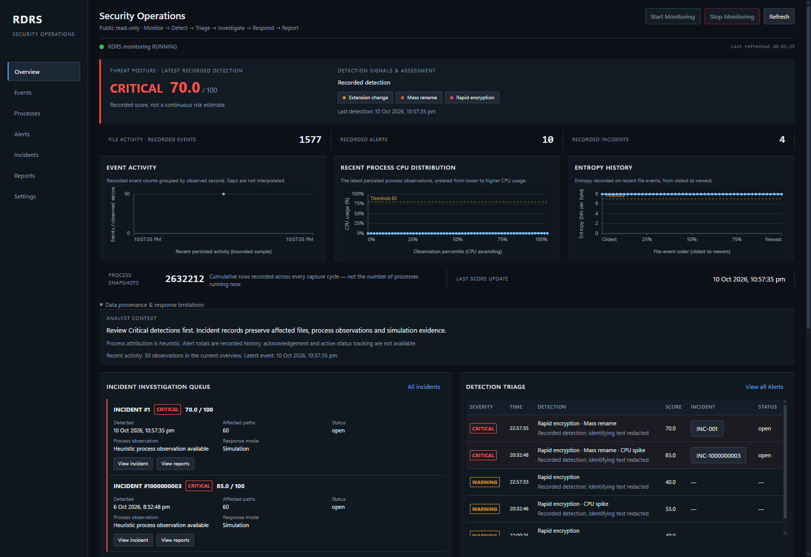
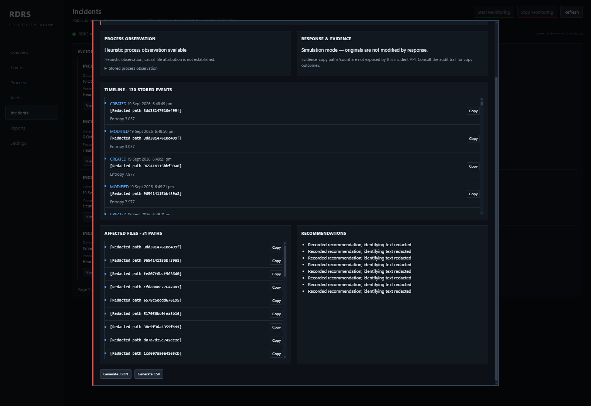
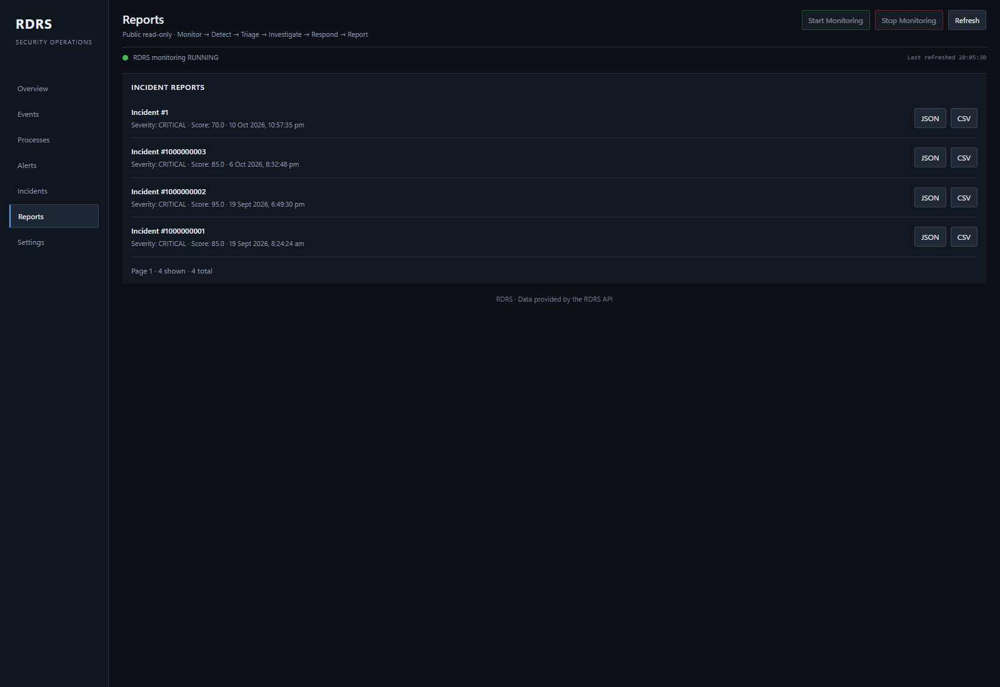

# RDRS — Ransomware Detection & Response System

## [Live SOC Dashboard → rdrs.samyaktech.in](https://rdrs.samyaktech.in/)

A local-first defensive toolkit that watches configured paths for
ransomware-like file activity, records telemetry, scores bursts, and reports
incidents. It monitors only paths configured in `config.yaml`; it is not
host-wide protection by default.

> **Defensive tooling only.** RDRS detects ransomware-like behaviour and copies
> evidence for analysis. It never encrypts, never destroys data, and never
> kills real processes. Quarantine is copy-only and simulation mode is on by
> default.

## Implemented scope

| Area | Requirement | Status |
| --- | --- | --- |
| Config loading & validation | FR-01 | Implemented |
| Real-time file monitoring (create/modify/rename/delete) | FR-02 | Implemented |
| Shannon entropy analysis | FR-03 | Implemented |
| Process telemetry (`psutil`) | FR-04 | Implemented |
| SQLite persistence | FR-05 | Implemented |
| Sliding-window burst detection | FR-06 | Implemented |
| Weighted 0–100 threat scoring | FR-07 | Implemented |
| Alerts & incident records | FR-08 | Implemented |
| Evidence quarantine (copy-only) | FR-09 | Implemented |
| REST API | FR-10 | Implemented |
| Live dashboard | FR-11 | Implemented |
| JSON / CSV reports | FR-12 | Implemented |
| Automated tests + Docker | FR-13 | Implemented; dated verification below |

Scope is FR-01–FR-13 and Build Guide Phases 1–10. See
[authoritative scope](docs/AUTHORITATIVE_SCOPE.md) and
[release verification](docs/RELEASE_VERIFICATION.md). Historical local Docker
failures are distinct from the verified hosted service. Windows Docker
bind-mount notification delivery remains unverified for the target host.

Threat bands: **Normal** `<40`, **Warning** `40–<70`, **Critical** `>=70`, capped
at 100. Scoring weights (Build Guide Phase 5): rapid encryption 40, mass rename
30, high entropy 25, CPU spike 15, unknown program 10.

## Requirements

- Python `>=3.11` per `pyproject.toml`; the Build Guide recommends 3.12 or newer,
  and the container uses Python 3.13.
- Dependencies: `python -m pip install -e . -r requirements.txt`.
- Node.js for the dashboard test harness; Docker/Compose for container execution.

## Technology stack

- Python, FastAPI, and Uvicorn for the runtime API and dashboard server.
- watchdog for filesystem notifications and psutil for process snapshots.
- SQLAlchemy with SQLite for persisted events, alerts, incidents, and history.
- YAML configuration and a single-page HTML/CSS/JavaScript dashboard.
- Node.js dashboard harness and pytest backend/integration tests.
- Docker Compose and Nginx for container execution and restricted HTTPS access.

## Quick start

```bash
python -m venv .venv
# Windows: .venv\Scripts\activate
# Linux/macOS: source .venv/bin/activate
python -m pip install -e . -r requirements.txt

# Start the API + dashboard on http://127.0.0.1:8000
python -m uvicorn rdrs.api:app --host 127.0.0.1 --port 8000
```

Open `http://127.0.0.1:8000/` for the dashboard.

The server loads the repository's `config.yaml`. Set `runtime.watch_paths` only
to directories intended for monitoring. The sample configuration watches
`data/`; persistence is enabled by default, and simulation mode is on by
default. Never point a demonstration at personal or production data.

## CLI

```bash
rdrs status
rdrs start
rdrs stop
```

The CLI uses the same runtime and configuration as the API. Monitoring control
commands are local administrative operations, not public reviewer actions.

## REST API

| Method | Path | Purpose |
| --- | --- | --- |
| GET | `/` | Live dashboard (HTML) |
| GET | `/health` | Runtime + subsystem health |
| GET | `/status` | Runtime status snapshot |
| POST | `/monitor/start` | Start filesystem monitoring |
| POST | `/monitor/stop` | Stop filesystem monitoring |
| GET | `/events` | Persisted file events |
| GET | `/processes` | Process telemetry snapshots |
| GET | `/alerts` | Alerts raised |
| GET | `/incidents` | Incidents raised |
| GET | `/dashboard-data` | Counts, recent records and chart samples |
| GET | `/public-summary` | Gateway access mode and allowlisted summary |
| GET | `/scan` | Return scan usage information (local only) |
| POST | `/scan` | Trigger a scan with a filesystem path |
| GET | `/reports` | List incidents eligible for reports |
| POST | `/reports/generate` | Generate a JSON/CSV incident report |
| GET | `/reports/{incident_id}/{format}` | Download an existing report (`json` or `csv`) |
| POST | `/settings` | Update settings and persist the configuration |

Collection reads support bounded limits and cursor pagination. A report download
returns 404 if no generated file exists. Public report controls download
existing redacted reports without generating files. Public administrative
methods, scan/settings routes and API documentation are blocked; `/docs` is
available through authorized local access.

## Operational logs

Five size-rotated logs are written under the configured `logs_dir`
(Build Guide Phase 1):

| Log | Contents |
| --- | --- |
| `system.log` | Runtime lifecycle transitions |
| `events.log` | Observed file events |
| `alerts.log` | Threat detections and alerts |
| `errors.log` | Pipeline and runtime failures |
| `audit.log` | Critical-incident audit trail |

## Docker

One-command startup:

```bash
docker compose up --build
```

Then open <http://127.0.0.1:8000>.

Useful local commands:

```bash
docker compose up --build -d
docker compose ps
docker compose logs -f rdrs
docker compose down
docker compose up --build --force-recreate
```

These are operator commands for a local/replacement instance. Do not stop,
recreate or test the live reviewer deployment without separate approval.

### Image

| Property | Value |
| --- | --- |
| Base | `python:3.13-slim` — satisfies the package and Guide requirements |
| Working directory | `/app` |
| User | `rdrs` (uid 1001, system account), not root |
| Container port | `8000` |
| Published host port | `127.0.0.1:8000` (loopback only) |
| Entrypoint | `uvicorn rdrs.api:app --host 0.0.0.0 --port 8000` |
| Healthcheck | HTTP 200 plus JSON `healthy: true` from `/health` |
| Build context | Filtered by `.dockerignore`; excludes live data, credentials and caches |

Writable paths `/app/data` and `/app/logs` are owned by `rdrs` and backed by host
bind mounts. Runtime evidence stays outside the image.

### Volumes

| Host | Container | Holds |
| --- | --- | --- |
| `./data` | `/app/data` | SQLite database, sandbox, reports and quarantine copies |
| `./logs` | `/app/logs` | Rotating system/events/alerts/errors/audit logs |
| `./config.yaml` | `/app/config.yaml` | Canonical FSD FR-01 configuration |

`config.yaml` is mounted read-write intentionally: authorized local
`POST /settings` persists changes. Public callers cannot change it. The sample
configuration watches `/app/data`, not arbitrary host directories.

### Persistence

- **Enabled:** `data/rdrs.db` lives on the host through the bind mount, so history
  survives container replacement and image rebuilds.
- **Disabled:** the runtime uses an in-memory database; the existing durable file
  is left untouched and becomes visible again when persistence is enabled.

### Docker verification status

**Historical runtime verification (2026-10-08):** Docker Engine 29.8.0 and
Compose 5.5.1 built the image with `docker compose build --no-cache`. The container
reached healthy, `/health` and `/status` reported a running runtime, the published
port was loopback-only, and bind-mounted history survived restart. Static Docker
configuration checks passed 49 tests.

**Historical local check (2026-10-09):** a separate local Docker database reported
`database disk image is malformed`, with an unhealthy process monitor and a
failing dashboard-data read. That original database was not repaired. This dated
failure is not a claim that the hosted deployment is unhealthy.

The exact-count storage fix maintains a persistent SQLite aggregate and
transactional triggers rather than scanning millions of process rows on each
refresh. In the recorded post-fix run, a direct count and the aggregate both read
2,426,282 rows. Five dashboard-data requests measured 61.30, 114.60, 21.60, 17.90
and 31.41 ms (median 31.41 ms). Three browser first-data measurements were 175.1,
64.2 and 59.0 ms (median 64.2 ms). The full verification count itself took 8.101
seconds. These are historical benchmarks, not current latency guarantees.

To check a local or isolated replacement runtime:

```bash
docker compose up --build -d
docker compose ps
curl -s http://127.0.0.1:8000/health
curl -s http://127.0.0.1:8000/status
# In an isolated sandbox only, verify a safe detection and existing reports.
```

See [deployment documentation](deploy/README.md) for the VPS architecture and
[dated verification](docs/RELEASE_VERIFICATION.md) for the later hosted checks.

## Testing

```bash
python -m pytest tests/ -q
```

The suite covers configuration, entropy, detection, scoring, persistence,
response, API, dashboard data, reporting and runtime lifecycle. Tests must use
temporary configuration and storage, never the active `data/rdrs.db` or private
production evidence. No production monitoring simulation is needed for a
documentation or screenshot update.

### Front-end verification

The dashboard JavaScript is executed, not just inspected. The Node harness
loads the real script block from `src/rdrs/dashboard/index.html` into a VM with
a DOM stub and drives refresh, monitoring controls, settings and pagination:

```bash
node tests/dashboard_frontend_harness.mjs
```

Node.js is a test prerequisite; isolated mocks in this unit harness are not
represented as live end-to-end runtime verification. Actual Chrome/API checks
are recorded separately.

### Environment note — editable install path

An editable install must resolve this checkout's `src` directory. A stale path
to another project copy can make tests exercise one tree while Uvicorn runs
another. Verify package resolution without modifying the environment:

```bash
python -c "import rdrs; print(rdrs.__file__)"
```

## Safety

- Detection and response only; no offensive capability.
- Quarantine copies evidence; originals are never modified or removed.
- Simulation mode is enabled by default; no real process termination.
- Test only in the dedicated Build Guide sandbox, not personal or production data.

## Architecture

RDRS is a single Python package with one responsibility per module. The runtime
owns lifecycle; the API and dashboard consume the same underlying records.

```text
                    ┌──────────────────────────────┐
                    │   cli.py / api.py (FastAPI)  │
                    └───────────────┬──────────────┘
                                    │
                    ┌───────────────▼──────────────┐
                    │        runtime.py            │
                    │  RuntimeManager / Status     │
                    └──┬────────┬────────┬─────────┘
                       │        │        │
        ┌──────────────▼─┐ ┌────▼─────┐ ┌▼──────────────┐
        │ monitoring.py  │ │telemetry │ │  storage.py   │
        │ watchdog file  │ │  .py     │ │ SQLAlchemy +  │
        │ events (FR-2)  │ │ (FR-4)   │ │ SQLite (FR-5) │
        └───────┬────────┘ └────┬─────┘ └───────┬───────┘
                │               │               │
        ┌───────▼───────────────▼───────────────▼───────┐
        │            burst_detection.py (FR-6)          │
        │   sliding time window → active signals       │
        └───────────────────┬──────────────────────────┘
                            │
                 ┌──────────▼──────────┐
                 │    scoring.py       │
                 │   weighted 0–100    │
                 └──────────┬──────────┘
                            │
                 ┌──────────▼──────────┐
                 │    response.py      │
                 │    quarantine.py    │
                 └──────────┬──────────┘
                            │
                 ┌──────────▼──────────┐
                 │ dashboard_data.py   │
                 │ dashboard/index.html│
                 └─────────────────────┘
```

Supporting modules include `config.py` / `config_engine.py` for validation and
comment-preserving saves, `entropy.py` for Shannon entropy over a 64 KB sample,
`logging.py` / `audit.py` for rotating logs, `events.py` for the event bus,
`health.py` for subsystem health, `policy.py` / `workers.py` for supporting
runtime operations, and `fileaccess.py` for shared-mode file reads.

File events and process snapshots are persisted, then evaluated in a sliding
window. Fired signals produce a weighted score. Critical detections create
alerts/incidents and copy evidence to quarantine. The highest-CPU process
observation is a heuristic association; it does not prove causal attribution of
file operations. The dashboard reads an aggregate payload from the API rather
than querying the database directly. Public responses pass through
`public_redaction.py` before leaving the server.

## Detection signals and false positives

| Signal | Fires when | Default weight |
| --- | --- | --- |
| `rapid_encryption` | Many distinct files are modified inside the window | 40 |
| `mass_rename` | Rename activity exceeds the configured threshold | 30 |
| `high_entropy` | Average entropy of modified files is high | 25 |
| `cpu_spike` | The observed suspect process is CPU-busy | 15 |
| `unknown_program` | The observation has neither a readable name nor executable path | 10 |

Rename and extension-change counters contribute to the burst analysis. Bands
are Normal `<40`, Warning `40–<70`, Critical `>=70`; only Critical creates an
incident.

False positives are a practical risk for this heuristic detector:

- **High entropy:** compressed archives, encrypted backups, disk images and
  media are legitimately high-entropy. A multi-file burst is more informative
  than a single high-entropy file.
- **Mass rename:** bulk organisation, extraction and build workflows can rename
  many files rapidly.
- **Rapid modification:** backup restores, bulk metadata edits and formatters
  can resemble encryption-like activity.
- **Resource observations:** legitimate builds/video encoding can spike CPU;
  missing process metadata does not establish malicious execution.

Window thresholds, correlated signals and weighted scoring reduce reliance on
any one signal. CPU spike and unknown-program weights alone cannot reach
Critical. Monitoring excludes RDRS's own output, but a dedicated known-good
process/path allowlist and broader backup/archive exception tuning are not
claimed as implemented.

## Persistence modes

`persistence.enabled` is configured in `config.yaml`; authorized local settings
changes are accepted only in the permitted runtime state.

| Mode | Behaviour |
| --- | --- |
| Enabled | File-backed SQLite history survives a process restart |
| Disabled | In-memory records survive monitoring stop/start but are lost when the process exits |

Changing persistence mode replaces the database manager. The durable database
is not deleted: enabling persistence makes its history visible again. Turning
persistence off hides that durable history from the active runtime rather than
erasing it. Both modes retain their active data across monitoring stop/start
within one process.

## Known limitations

- Windows Docker bind-mount filesystem notifications remain unverified for the
  target host; native watchdog behaviour can differ from host-side monitoring.
- There is no login/account system. Local administration is trusted and
  origin-checked; the hosted gateway explicitly permits redacted reads and blocks
  mutations/admin routes. Backend port 8000 is loopback-only.
- Public identifying paths/names/commands and unapproved evidence are withheld.
  Pseudonyms are per server process and may change on restart. Free-text reports
  and some metadata are redacted rather than fully exposed.
- Process/file attribution is heuristic, not proven responsible-process tracking.
- The SQLite/in-process architecture is single-runtime, not multi-replica.
- Long-running process history needs retention planning; no automatic deletion
  is implied. Dependencies are not fully pinned.
- Hosted monitoring covers configured mounted paths and container processes,
  not visitors' computers or comprehensive VPS/Windows host protection.

## Verification status

The following results retain their dates and scope; they are not a new full-suite
or coverage claim:

| Area | Recorded result |
| --- | --- |
| Full backend suite, 2026-10-08 | 835 passed, 0 failed, 0 skipped |
| Line coverage, 2026-10-08 | 94% (3,557 statements) |
| Original dashboard harness, 2026-10-09 | 124 passed, 0 failed |
| Encoding/safety scan, 2026-10-09 | 22/22 passed |
| Docker static configuration, 2026-10-09 | 49 passed |
| Scoped release regression, 2026-10-12 | 246 passed; 124 frontend checks passed |
| API/redaction and frontend checks, 2026-10-15 | 34 passed; 124 frontend checks passed |
| Fresh isolated Docker/redaction verification, 2026-10-16 | 51 passed |
| Fresh read-only local quarantine verification, 2026-10-16 | 10/10 saved copies matched originals by SHA-256 |

The genuine safe-sandbox run produced Critical 85/100, incident #1, ten verified
quarantine copies and sanitized reports/logs. A separate October 9 isolated
dashboard run showed 202 events, 454 process observations, two alerts and one
incident. Historical October 8 Docker build/restart verification and later
October 9 local corruption were separate checks. Do not conflate these with
the later hosted deployment.

Actual Chrome comparisons verified all seven hosted/local pages, pagination,
four incident timelines and existing report downloads. Current domain HTTPS and
read-only access checks are documented in [release verification](docs/RELEASE_VERIFICATION.md).

## Design, testing and future improvements

**Design choices.** Modules separate monitoring, detection, scoring, response
and reporting so each stage can be tested in isolation. SQLite avoids a separate
database service. The runtime owns database lifecycle: read endpoints do not
dispose the shared engine, preventing races with concurrent readers. Indexed
counts and bounded payloads avoid scanning full process history on every poll.
A historical local benchmark on roughly 980k process rows measured about 0.08 s
dashboard reads after optimization, down from about 8.5 s; it is not a current
release performance claim.

**How it was tested.** Unit/integration tests cover storage, entropy, scoring,
API and lifecycle. The Node VM harness executes the real frontend functions,
including cursor paging and settings-edit state. Encoding/safety checks cover
source/response encoding and simulation defaults. The live safe-sandbox E2E
verified the event-to-incident-to-report chain. Docker build, health, shutdown,
restart and persistent history were exercised in dated runs. Fresh screenshot
verification is limited to real read-only views and isolated temporary tests.

**False-positive example.** Archiving a project can combine many writes/renames
with high-entropy output. A single archive is not equivalent to a correlated
multi-file burst, but bulk operations can still raise warnings or Critical
scores. Known-good path/process exclusions would improve operational tuning.

Priorities for future work, not features claimed by this release:

1. Known-good path/process allowlists for trusted backup, archive and build workloads.
2. Target-platform Windows Docker notification validation.
3. Explicit account-based API authorization for broader deployment models.
4. Process-history retention and richer alert lifecycle management.
5. Broader false-positive and cross-platform validation.

## Application GUI screenshots

These four genuine screenshots were captured directly from the running
read-only application on **2026-10-16 UTC**. Monitoring status and counters
reflect capture time; recorded incident timestamps are historical. No saved
images, terminal output or generated verification pages were used as sources.

### 01 — SOC Dashboard



The actual SOC Overview shows monitoring status, event/alert/incident KPIs and
CPU/entropy charts. Its Critical 70/100 score is a recorded October 10 detection,
not evidence of a newly triggered attack.

### 02 — Incident Investigation


Genuine incident #1 contains 60 affected paths and a 145-event report timeline.
Identifying paths/process details are redacted publicly; no incident or report
was generated to obtain this screenshot.

### 03 — Response / Evidence



The incident dialog's Response & Evidence pane displays genuine simulation-mode
response status. It does **not** expose quarantine copy counts, paths or integrity
results; this screenshot is not quarantine-copy verification.

### 04 — Reports



Four genuine stored incidents expose existing JSON/CSV download controls.
Public downloads are redacted and do not generate new evidence. Sample
[JSON](submission/evidence/reports/incident_report.json),
[CSV](submission/evidence/reports/incident_report.csv) and
[log excerpts](submission/evidence/logs/incident_log_excerpts.jsonl) retain the
separately documented historical safe run.

## Deployment status and reviewer access

**Public read-only dashboard:** https://rdrs.samyaktech.in/

The domain uses a validated Let's Encrypt certificate and resolves to the
existing VPS at `192.46.208.222`; the IP endpoint is the legacy URL. The VPS runs
independently of the laptop. Initial October 10 storage was followed by historical
import; current reads preserve real record IDs, timestamps, scores, signals and
numeric telemetry. Administrative requests and scan/settings/docs routes remain
blocked publicly; raw private details require authorized loopback/SSH access.

The backend's host bind mounts preserve data/logs/configuration across image
replacement. Nginx enforces permitted methods/routes and forces backend redaction.
Private original reports are preserved, while public controls download redacted
existing files. Pseudonyms are consistent during one server process. Clipboard
copy uses the browser's secure-context API and reports denied access explicitly.

See [deployment architecture and operations](deploy/README.md),
[dated verification](docs/RELEASE_VERIFICATION.md) and the
[original safe-run write-up](submission/WRITEUP.md). Historical evidence remains
in its [evidence index](submission/evidence/README.md). This documentation update
does not modify application logic, production services or original evidence.
